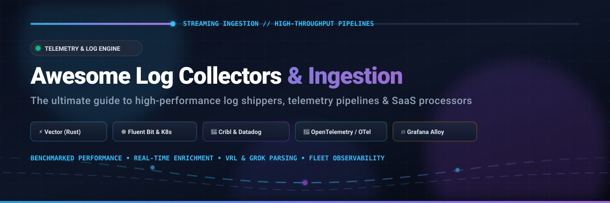

# Awesome Log Collectors & Ingestion 🚀

  

## 📑 Top Log Collectors, Telemetry Pipelines & Ingestion Ecosystem

**A Curated Directory of SaaS Telemetry Platforms & Open-Source Log Shippers**  
*Comprehensive landscape covering Log Forwarding, Pipeline Stream Transformation, Kubernetes DaemonSets & Self-Hosted Telemetry Agents*  
**Last updated: October 2026** 📅

This repository tracks notable **SaaS platforms** and **open-source projects** for **Log Collectors, Aggregators, and Ingestion Engines**. Sitting at the edge of your infrastructure—tailing log files, consuming container stdout/stderr, parsing syslog, journald, and Windows Event Logs, and streaming events to centralized analytic backends—these tools transform unformatted raw output into structured, enriched, and routable telemetry before network egress.

---

## 🧭 Table of Contents

- [📊 Sector Overview & Market Dynamics](#-sector-overview--market-dynamics)
- [☁️ SaaS / Hosted Platforms](#️-saas--hosted-platforms)
- [🛠️ Open-Source GitHub Projects](#️-open-source-github-projects)
- [🤝 How to Contribute](#-how-to-contribute)
- [📈 Star History](#-star-history)
- [⚠️ Disclaimer](#️-disclaimer)

---

## 📊 Sector Overview & Market Dynamics

The global log management and telemetry pipeline sector represents an estimated market size of **$3.8 Billion to $4.5 Billion** (projected to reach over **$10 Billion by the early 2030s** at an 11%–15% CAGR), nestled within the broader $13B+ unified observability and AIOps landscape. 

The sector is **moderately fragmented yet rapidly consolidating around multi-product observability platforms**: hyperscalers and mega-cap vendors (AWS, Cisco/Splunk, Datadog) command dominant enterprise spend, while independent pipeline routers like Cribl and standardized open-source standards (such as OpenTelemetry, Vector, and Fluent Bit) prevent complete "winner-take-all" capture by enabling workload portability and edge pre-processing.

---

## ☁️ SaaS / Hosted Platforms

Below are the leading commercial platforms for managed log ingestion, enterprise routing, and observability indexing, sorted descending by company size (market valuation / revenue).

| Product | Company Size (Valuation / Revenue) 🏢 | Description 📝 | Pricing 💰 | Free Tier Limit 🎁 |
| :--- | :--- | :--- | :--- | :--- |
| **[AWS CloudWatch Logs](https://aws.amazon.com/cloudwatch/)** | **~$2.0T+** Market Cap / AWS **$100B+ ARR** run-rate | Native AWS telemetry collection via CloudWatch Agent, VPC Flow Logs, and subscription filters. | **$0.50/GB ingested**, **$0.03/GB/month archived**, **$0.005/GB scanned** by Logs Insights (US East). | **5 GB data/month** permanently free (ingestion, archive storage, and Insights scans combined across AWS account). |
| **[Datadog](https://www.datadoghq.com/)** | **~$50B+** Market Cap / **$2.5B+** TTM Revenue | Managed agent-based log collection with real-time pipelines, Sensitive Data Scanner, and cold-storage routing. | Ingestion starts at **$0.10/GB ingested**; indexing starts at **$1.06 per million log events** (15-day retention); overages incur a 50% premium. | **Infrastructure Free**: Up to 5 hosts with 1-day metric retention; for log ingestion, Datadog provides a **14-day fully-featured free trial** (no permanent free log volume). |
| **[Splunk Forwarder](https://www.splunk.com/)** | **$28B** Acquisition (Cisco) / **$4.3B+ ARR** | High-throughput Universal Forwarder (UF) and Heavy Forwarder (HF) collecting and streaming enterprise operational data. | Forwarder agent binary is **free**; backend indexing workload costs range from **$150 to $225/GB/day** (or workload-based SVC pricing). | Forwarder binary has no license cost; backend indexing offers **Splunk Free** permanently capped at **500 MB/day** indexing (single-user, no alerting/clustering) or a **14-day Splunk Cloud free trial** (5 GB/day). |
| **[New Relic Logs](https://newrelic.com/)** | **$6.5B** Acquisition (Francisco/TPG) / **~$1B** Revenue | Observability telemetry engine featuring unified log-to-metrics/traces correlation and compliance archiving. | Starts at **$0.35/GB ingested** beyond free allowance for standard data (or retention tiers: 8-day at $55/GB/day, 15-day at $65/GB/day, 30-day at $75/GB/day). | **100 GB/month permanently free** for all telemetry data (logs, metrics, traces) with 8-day retention and 1 full-platform user. |
| **[Cribl Stream](https://cribl.io/)** | **$3.7B** Valuation / **$300M+ ARR** | Vendor-agnostic observability stream pipeline for parsing, masking, deduping, and routing telemetry before egress. | Pay-as-you-go credit model: **$0.13 to $0.20 per credit** (12 MB/s stream throughput = 1.3–2.0 credits/hr; 60 MB/s = 6.5–10.2 credits/hr). | **Cribl.Cloud Free Tier**: **1 TB/day (1,000 GB/day)** log ingestion and processing allowance permanently free, single worker group, community support. |
| **[Sumo Logic](https://www.sumologic.com/)** | **$1.7B** Acquisition (Francisco Partners) / **~$242M** Revenue | Cloud-native multi-tenant analytics engine with ingest budgets, field extraction rules, and Flex licensing. | Essentials tier starting at **$2.50 to $3.00/GB ingested**; or **Flex Licensing**: **$0.00/GB ingest fee** and **$3.14/TB scanned**. | **30-day free trial** with up to 1 GB/day ingest and 20 search queries/day; Sumo Logic Free tier grants **Up to 1 GB/day log data transfer** with 4 concurrent searches and 7-day retention. |
| **[Papertrail (SolarWinds)](https://www.papertrail.com/)** | **$41M** Acquisition (SolarWinds) | Rapid cloud-hosted syslog and event aggregation with instant live tail, log velocity alerting, and search archiving. | Starts at **$7/month** (for 1 GB/month with 1-week search retention and 1-year archive storage); additional volume at **$2 to $3/GB**. | **Papertrail Free**: **50 MB/month permanently free** (with a 48-hour search retention window, 7-day archive, and 1 user account). |

---

## 🛠️ Open-Source GitHub Projects

All open-source log forwarders, stream processors, and agents are sorted below in descending order by **GitHub Star Count** ⭐. Click each star badge to view stargazers.

- **[Grafana Loki](https://github.com/grafana/loki)**   
  **Like Prometheus, but for logs.** Horizontally-scalable, highly-available, multi-tenant log aggregation system. Indexes only metadata (labels) rather than the entire log payload, drastically reducing operational overhead and storage costs compared to traditional search engines. Integrates natively with Grafana dashboards and LogQL query syntax.

- **[Vector](https://github.com/vectordotdev/vector)**   
  **The ultra-high-performance Rust-based telemetry pipeline.** Developed by Timber.io (now Datadog) under MPL 2.0. Demonstrates top-tier disk throughput (over **76.7 MiB/s** in standard benchmarks) with ultra-low memory footprints (~188 MiB). Features **VRL (Vector Remap Language)** for inline schema validation, mutation, payload enrichment, and multi-cloud fan-out routing without JVM overhead.

- **[Logstash](https://github.com/elastic/logstash)**   
  **The Elastic Stack's enterprise transformation backbone.** Java-based server-side pipeline engine offering the deepest processing catalog available: Grok pattern matching, conditional branching, and hundreds of input/filter/output integrations. Best suited as a centralized aggregation tier for complex parsing before shipping to Elasticsearch or OpenSearch.

- **[Fluentd](https://github.com/fluent/fluentd)**   
  **The CNCF Graduated unified logging tier.** Ruby- and C-based log aggregator featuring over 1,000+ battle-tested community plugins. Standardizes structured JSON records across disparate applications and cloud providers with pluggable buffering and fallback routing mechanisms.

- **[Redpanda Connect (formerly Benthos)](https://github.com/redpanda-data/connect)**   
  **Streamlined, resilient stream processor in Go.** Built with declarative YAML configurations, Bloblang mapping language, and zero external runtime dependencies. Operates as a resilient log broker, protocol translator, and multiplexer for enterprise streaming architectures with sub-millisecond latency.

- **[Fluent Bit](https://github.com/fluent/fluent-bit)**   
  **The CNCF lightweight C collector for Kubernetes & Edge.** Engineered for minimal memory footprint (~15-30 MB) and massive event throughput (benchmarked at **31,300+ logs/second**). Commonly deployed as a Kubernetes DaemonSet, sidecar, or IoT agent collecting container logs, systemd journal events, and forwarding directly into Kafka, Loki, Elasticsearch, or S3.

- **[Graylog Server](https://github.com/Graylog2/graylog2-server)**   
  **Open-source centralized log management and SIEM platform.** Offers high-volume log capture (via GELF, Syslog, Beats), structured pipeline stream processors, fast search querying over Elasticsearch/OpenSearch, and built-in role-based access control and compliance dashboards.

- **[OpenTelemetry Collector](https://github.com/open-telemetry/opentelemetry-collector)**   
  **The vendor-neutral CNCF observability standard.** Provides high-throughput ingestion, filtering, and export for logs, traces, and metrics under a single unified binary. Includes standard receivers for filelog, journald, syslog, and OTLP protocols, backed by an extensive library of processors in [opentelemetry-collector-contrib](https://github.com/open-telemetry/opentelemetry-collector-contrib).

- **[Grafana Alloy](https://github.com/grafana/alloy)**   
  **The official successor to Promtail.** Vendor-neutral OpenTelemetry Collector distribution with built-in native support for Prometheus metrics, Loki log tailing, and Pyroscope profiling. Uses a declarative configuration syntax with dynamic component reloads, replacing legacy Promtail deployments.

- **[Syslog-ng](https://github.com/syslog-ng/syslog-ng)**   
  **High-performance system logging daemon.** Supports RFC 3164/5424 syslog, JSON parsing, message classification, pattern databases, and reliable delivery across TLS, disk buffers, and message queues.

- **[Rsyslog](https://github.com/rsyslog/rsyslog)**   
  **The default, rocket-fast syslog utility on Linux distributions.** Highly optimized C architecture capable of processing over one million messages per second. Features flexible rule engines, queuing modes, multithreading, and direct database outputs.

---

## 🤝 How to Contribute

Contributions are welcome and appreciated! Follow these steps:

1. 🍴 **Fork the repository**.
2. 🌿 **Create a branch** for your feature or tool addition (`git checkout -b feat/add-collector`).
3. 📝 **Add or edit entries in `README.md`** following the established format, keeping descriptions objective, accurate, and benchmark-informed.
4. ⭐ **Ensure links and badges are valid**.
5. 🚀 **Submit a Pull Request** with a brief overview of changes.

---

## 📈 Star History

---

## ⚠️ Disclaimer

- This is a **community-curated repository** intended for architectural reference, educational comparisons, and engineering research.
- **Collector benchmarks are strictly workload-dependent**: Raw throughput, memory allocation, and GC pauses vary greatly depending on parsing complexity (e.g. Grok vs. VRL vs. pure Regex), disk queue I/O, network latency, and payload sizes. Evaluate agents in an environment matching your production load.
- **Agent licensing vs. Backend storage costs**: Forwarders like Splunk UF, CloudWatch Agent, and Vector are freely distributed, but destination storage, indexing, and data transfer fees can escalate quickly. Always plan full lifecycle retention costs.
- **Promtail Deprecation**: Grafana Promtail has reached end-of-life / deprecation; all modern Loki deployments should adopt Grafana Alloy or the OpenTelemetry Collector.

---

<b>Crafted for SREs, Platform Engineers, and Cloud Architects building scalable telemetry pipelines.</b> ⚡

